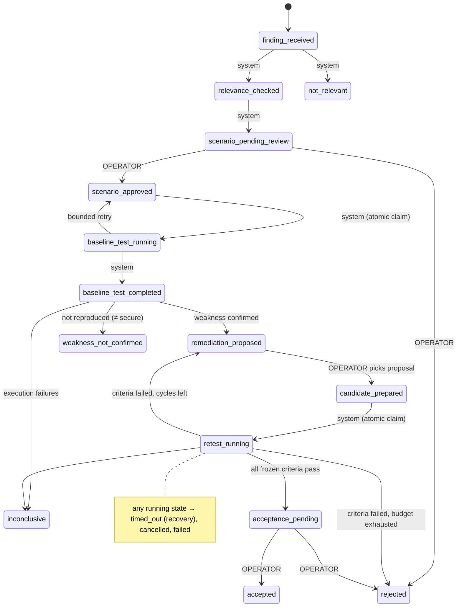

# SAGE-IDS Architecture

## Component view

```mermaid
flowchart LR
  subgraph Internet["Trusted public sources (read-only)"]
    NVD[(NVD CVE API 2.0)]
    ATT[(MITRE ATT&CK STIX)]
  end
  subgraph Core["SAGE-IDS core (Python, SQLite)"]
    TR[Threat Research Agent<br/>fetch · cache · rate-limit · dedup<br/>provenance · relevance]
    CO{{Coordinator<br/>persistent bounded state machine}}
    AV[Adversarial Validation Agent<br/>approved catalogue only]
    MO[Network Monitoring Agent<br/>lab-v1 windows · rules · RF · IF]
    RE[Remediation Agent<br/>rule template · lab config · verified retrain]
    EX[Explanation Agent<br/>deterministic evidence report]
    VR[(Version registry<br/>candidate / accepted / rollback)]
    AU[(Hash-chained audit ledger)]
    AC[Acceptance gate<br/>criteria frozen + SHA-256 committed]
  end
  subgraph Lab["Isolated laboratory (loopback / internal Docker network)"]
    AL[[Allowlist guard<br/>every connect()]]
    T1[Dummy login service]
    T2[Test web app]
    T3[Decoy listeners]
    SN[Lab sensor / Zeek / Suricata]
  end
  OP((Operator<br/>dashboard / API))
  NVD --> TR
  ATT --> TR
  TR -->|finding + candidate scenario| CO
  OP -->|approve / prepare / accept / rollback| CO
  CO --> AV
  AV --> AL --> T1 & T2 & T3
  T1 & T2 & T3 --> SN --> MO
  MO -->|executed · effect · detected| CO
  CO --> RE --> VR
  CO --> AC --> VR
  CO --> EX
  CO --> AU
  VR --> MO
```

## Closed-loop state machine



Every transition is checked against `(from, to) → allowed roles`
([state_machine.py](../sage_ids/coordinator/state_machine.py)), persisted as a `Transition` row with
its evidence, and appended to the SHA-256 hash-chained audit ledger ([audit.py](../sage_ids/audit.py)).

## Key mechanisms

| Mechanism | Where | Purpose |
|---|---|---|
| Tri-outcome ledger | `ExperimentRun.executed`, `.effect_occurred`, `RunDetection.detected` | execution, security effect and detection are never conflated |
| Ground truth by construction | `MonitoringAgent._label` | a window is labelled only if it comes from an executed scenario's source address/time or from the benign generator; everything else stays unlabelled and never enters training |
| Paired evaluation | `Coordinator._run_phase` | baseline and candidate detectors are evaluated on the *same* retest telemetry → exact McNemar test |
| Criteria pre-commitment | `evaluation/acceptance.py` | numeric criteria derived from the measured baseline, frozen, SHA-256 committed in the audit log *before* any candidate is evaluated; evaluation refuses a mismatching hash |
| Fresh-seed separation | `Coordinator._seed` | proposal creation uses baseline-phase data; acceptance uses retest seeds never seen during creation; final held-out test uses a third seed range |
| Atomic claim | `Coordinator._claim` | `UPDATE … WHERE state = from` compare-and-set prevents duplicate execution |
| Bounded adaptation | `max_retries`, `max_adaptation_cycles` | no unbounded self-modification |
| Versioned bundles | `DetectorVersion` | rules + model (SHA-256) + lab config + feature schema hash + label-set digest, hashed together; tampered bundles cannot be accepted |
| Allowlist in code | `security/allowlist.py` | re-validated on every socket connect, independent of any LLM text |
| Sliding-window rules | `detection/rules.py` | rule features identical to lab-v1, evaluated on a per-source sliding window for online latency and no boundary splitting |

## Data separation

* **Laboratory model** (`lab-v1` schema, 14 window features) — runtime-reproducible from lab-sensor,
  Zeek or replayed events.
* **Benchmark model** (CICIDS2017 78-feature schema / UNSW-NB15 schema) — trained and evaluated
  separately by `sage-ids benchmark`; never claimed compatible with live telemetry.
